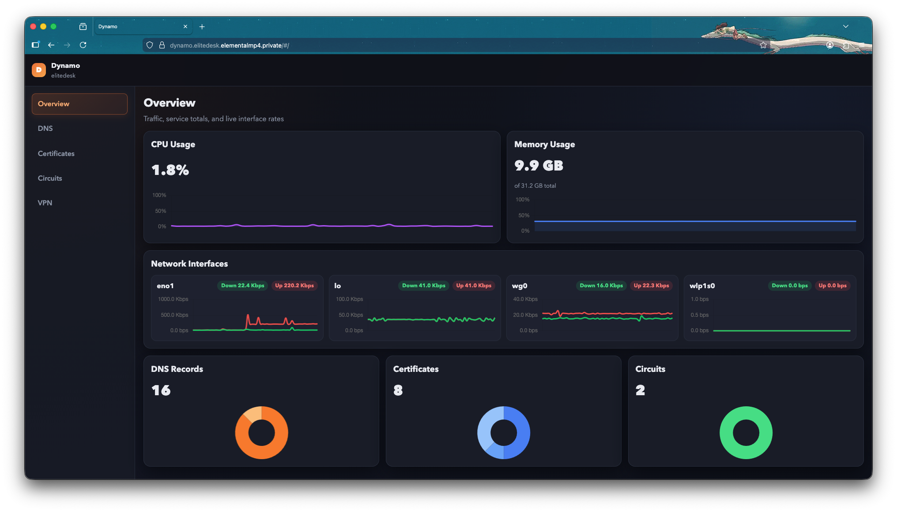

# Dynamo

Network Management Platform



## Features

- Built-in DNS resolver with optional DNS over TLS to upstream servers
- Creates Root CAs, Service Certificates & Client Certificates
- Creates Nginx mTLS-ready configurations with http -> https redirects & CRLs
- Manages iptables routing rules for a variety of redirects and circuit breakers
- Manages interfaces & client configurations for WireGuard

## Requires

- conntrack
- iptables (or nftables)
- wireguard

Dynamo also generates configuration files that can be included in Nginx, but Nginx is not a mandatory dependency.

## Example Nginx config

```nginx
include /etc/Dynamo/ssl/server/<service name>/nginx-redirect.conf;

server {
    include /etc/Dynamo/ssl/server/<service name>/nginx-mtls.conf;
    location / {
        proxy_pass http://127.0.0.1:8080;
    }
}
```

Include looks something like this:

```nginx
listen 443 ssl;
server_name <service name>;

ssl_certificate     /etc/Dynamo/ssl/server/<service name>/<service name>.crt;
ssl_certificate_key /etc/Dynamo/ssl/server/<service name>/<service name>.key;

ssl_client_certificate /etc/Dynamo/ssl/root/elitedesk/elitedesk.crt;
ssl_verify_client on;

ssl_protocols TLSv1.2 TLSv1.3;
ssl_prefer_server_ciphers on;
```

## DNS

Dynamo has its own built-in DNS resolver (it used to rely on dnsmasq, but no longer does). A, CNAME, TXT and SRV records are managed through the API/UI and served directly; any query that isn't answered locally is forwarded to the configured upstream servers.

Upstream forwarding can optionally use DNS over TLS (DoT, RFC 7858), which lets you point Dynamo at a provider like Mullvad's encrypted DNS without leaking plaintext queries. Set `tlsName` (used for SNI and certificate verification), then point `address` at the provider's DoT addresses on port 853, e.g. Mullvad's `base.dns.mullvad.net` (`194.242.2.4:853`).

## Dynamo Config File

```jsonc
{
    "system": { // Config for Dynamo itself
        "serverBind": "127.0.0.1:6789",
        "dnsmasqConfigFile": "/etc/dnsmasq.d/dynamo.conf",
        "dataDirectory": "/etc/Dynamo/data",
        "instance": "Elitedesk"
    },
    "certificates": { // Certificate configuration
        "certsDir": "/etc/Dynamo/ssl",
        "remoteCertUrl": "https://dynamo.cloud.elementalmp4.private/", // OPTIONAL *
        "remoteCertClientCert": "/etc/Dynamo/remote/client.crt", // OPTIONAL *
        "remoteCertClientKey": "/etc/Dynamo/remote/client.key", // OPTIONAL *
        "remoteCertTrust": "/etc/Dynamo/remote/cloud.crt" // OPTIONAL *
    },
   "dns": { // Config for the built-in DNS resolver
      "dnsBind": "0.0.0.0:54",
      "domain": "elementalmp4.private",
      "upstream": [
        {
            "address":"194.242.2.4:853", // Mullvad's base DNS (requires DoT)
            "tlsName": "base.dns.mullvad.net" // TLS name for the server
        },
        {
            "address": "1.1.1.1" // Cloudflare's DNS (Can use plain UDP)
        }
      ],
   }
}
```

(*) - remote certificate configuration is optional, only configure this if you run multiple Dynamo instances and need to share a single CA between them.